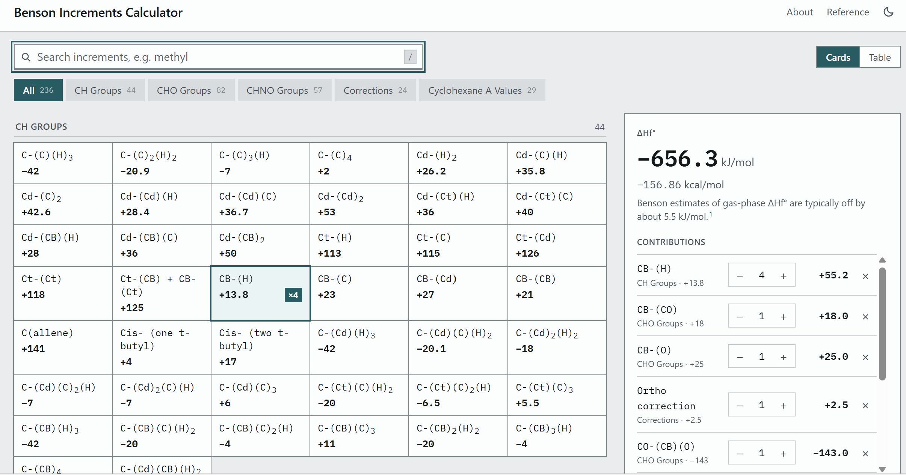

# Summary

Benson group additivity estimates the standard enthalpy of formation ($\Delta H_f^\circ$) of an organic molecule by adding contributions from the groups it contains, plus corrections for ring strain and steric effects [@benson1976; @cohen1993]. The Benson Increments Calculator is a browser-based tool designed for teaching the method. It handles arithmetic, unit conversion, and bookkeeping, while students perform the central chemical task: identifying constituent groups and required corrections.

The calculator provides 236 searchable group increments and corrections compiled from published literature. It maintains a running tally in both kJ/mol and kcal/mol alongside an explicit ledger of each selected contribution, and exports calculations as structured text for course assignments. Implemented as a static, dependency-free web application, the tool requires no local installation or account setup, running across modern desktop and mobile browsers. Both the source code and increment datasets are open source.

# Statement of Need

Group additivity is taught because it makes the connection between molecular structure and thermodynamic stability explicit. A student who learns to decompose a molecule into its constituent groups gains chemical intuition that the final numerical value alone does not convey [@benson1976; @anslyn2006].

Existing open-source programs, including RMG-Py [@rmgpy] and pGrAdd [@pgradd], automatically assign group increments from a SMILES or InChI string. This suits high-throughput work such as mechanism generation and kinetic modeling. However, in a pedagogical setting, these programs automate the exact conceptual step the student is meant to learn. Furthermore, these tools require local Python environments or command-line execution, which present technical barriers in classroom settings and are difficult to use on mobile devices during lectures or recitations.

The conventional pedagogical alternative relies on printed reference tables [@cohen1993; @anslyn2006]. In practice, values are spread across several dense tables in condensed typographical shorthand, such as `C-(C)2(H)2` and `Cd-(CB)(H)`. Manual lookup and multi-step arithmetic consume significant cognitive working memory that would otherwise be dedicated to chemical reasoning, while manual arithmetic or sign errors easily obscure whether a mistake was mathematical or conceptual [@sweller1988].

The Benson Increments Calculator bridges this gap (Table 1). The student retains full responsibility for the chemical reasoning—identifying the atom centers, coordination environments, and required corrections—while the software automates lookup, unit conversion, and bookkeeping. By rendering the step-by-step arithmetic explicitly, the tool ensures that erroneous results can be diagnosed immediately as conceptual group misassignments rather than mathematical slips.

| Feature / Dimension | Printed Tables [@anslyn2006; @cohen1993] | RMG-Py [@rmgpy] / pGrAdd [@pgradd] | Benson Increments Calculator |
|:---|:---|:---|:---|
| **Input Required** | Manual lookup & handwritten math | SMILES or InChI string | User-selected functional groups |
| **Structure Perception** | Manual | Automated (graph algorithms) | **Deliberately manual (pedagogical)** |
| **Arithmetic & Units** | Manual (error-prone) | Automated | **Automated (kJ/mol and kcal/mol)** |
| **Runtime / Platform** | Physical book or PDF | Python / Conda / terminal | **Zero-install web (desktop or mobile)** |
| **Pedagogical Focus** | Reference lookup | High-throughput kinetic modeling | **Active learning & group assignment** |

: Comparison of pedagogical and computational workflows for Benson group additivity.

# Learning Objectives

The tool was developed for upper-level undergraduate and first-year graduate students enrolled in Advanced Organic Chemistry (C450/C540) at Indiana University Bloomington. After engaging with the tool, students should be able to:

1. **Deconstruct molecular structures into group increments:** Identify the hybridization, oxidation state, and nearest-neighbor coordination sphere of each non-hydrogen atom, mapping them onto standard Benson notation (`Center-(Ligands)`);
2. **Identify non-nearest-neighbor interactions:** Recognize when simple nearest-neighbor additivity fails, selecting and applying appropriate ring-strain corrections (RSC), steric adjustments (e.g., *gauche* or *ortho* interactions), and stereochemical penalties; and
3. **Critically evaluate thermochemical estimates:** Distinguish standard gas-phase enthalpies of formation ($\Delta H_f^\circ$) from conformational free energies ($\Delta G^\circ$, such as cyclohexane $A$-values), compare estimates against experimental calorimetric benchmarks, and rationalize discrepancies arising from resonance, internal hydrogen bonding, or unparameterized steric strain.

# Use in Teaching

The calculator has been used in Advanced Organic Chemistry (C450/C540) for three years (22 students in Year 1, 17 in Year 2, and 12 in Year 3; average 17). 

The tool was originally introduced as a Jupyter notebook using `ipywidgets`. Because the majority of enrolled chemistry students had minimal prior programming experience, environment configuration, package installation, and troubleshooting consumed 20–30 minutes (roughly 30–50% of introductory class periods), causing substantial technical friction before chemical discussion could begin. Migrating to Google Colab in Year 2 eliminated local installation dependencies, but browser authentication hurdles and notebook interface overhead continued to demand disproportionate classroom support.

The standalone browser version, introduced in the Fall 2026 semester, eliminated technical setup entirely. By distributing the GitHub Pages URL at the start of class, students were able to launch the tool in seconds across laptops, tablets, and smartphones. Routine introductory exercises—such as decomposing and calculating $\Delta H_f^\circ$ for small molecules like ethanol or isopropanol—were completed in under five minutes, shifting instructional time almost entirely to chemical analysis.

Students use the calculator in three primary contexts: learning group decomposition on simple molecules during introductory lectures, analyzing literature thermochemistry during group projects, and estimating ground-state enthalpy levels to construct reaction coordinate diagrams. 

Because arithmetic and bookkeeping are automated, instructional time is focused on structural reasoning and mechanistic interpretation. The explicit ledger display also provides immediate diagnostic feedback: during in-class exercises, instructors can quickly pinpoint conceptual errors—such as assigning a carbonyl ligand (`CO`) as a saturated alkyl carbon (`C`), or omitting steric corrections on ortho-substituted aromatics—before mathematical mistakes obscure the underlying misunderstanding.

Beyond teaching thermochemistry, the project offered an opportunity to discuss how chemists can build their own software. As documented in the repository (AI_USE.md), the calculator was developed by pairing domain chemical knowledge with AI coding assistants to produce clean, dependency-free web code. Sharing this workflow with students showed them that software development is no longer restricted to computer scientists: with modern AI tools, bench chemists can automate repetitive laboratory calculations and build tailored computational utilities for their own research.

Archival lecture presentation slides, student onboarding exercises, and legacy Jupyter notebooks from earlier course offerings are maintained in the repository under [`teaching_materials/`](teaching_materials/).

# Design and Implementation

The Benson Increments Calculator is built with a two-tier architecture designed for stability, low overhead, and data transparency:

1. **Data Pipeline and Validation:** Source increment data are maintained in category-specific CSV files that domain chemists can inspect and edit directly. A standalone Python library (`benson`) parses and validates these files, verifying schema consistency, ensuring numerical values and published ranges are properly formatted, and confirming that group identifiers are unique. The pipeline compiles these tables into a single distribution payload (`dist/increments.json`). Automated continuous-integration checks run these validators and unit tests on every repository update.
2. **Client-Side Web Interface:** The web application is written in standard HTML5, CSS3, and modern JavaScript, containing no external libraries, third-party frameworks, or runtime dependencies. It loads the compiled JSON asynchronously, providing an instant search-and-select interface with a total payload under 100 kB. Because there is no build step or server dependency, the tool runs reliably across all modern desktop and mobile browsers, and can be downloaded to run entirely offline.

A Jupyter notebook reference implementation remains in the repository, allowing students interested in scripting to run identical calculations and query the underlying datasets programmatically.

# Interface and Pedagogical Features

### Search Normalization and Chemical Shorthand
Standard Benson notation is dense with punctuation (`O-(CB)(CO)`, `C-(C)2(H)2`), which makes exact character entry on mobile keyboards slow and error-prone. To reduce typographic friction, the search engine normalizes queries by stripping punctuation, parentheses, and hyphens while ignoring case. For example, entering `ocbco` surfaces both `O-(CB)(CO)` and `CO-(CB)(CO)` (\autoref{fig:search}). The search algorithm also indexes common colloquial names (such as `methylene` or `methyl`) and empirical shorthand (e.g., `CH3` for `C-(C)(H)3`).

### Preserving Source Precision and Thermodynamic Boundaries
The calculator enforces clear distinctions between thermodynamic state functions. While the primary database tabulates standard enthalpies of formation ($\Delta H_f^\circ$), it also includes cyclohexane $A$-values (conformational Gibbs free energies, $\Delta G^\circ$), which students frequently encounter alongside group additivity in physical organic courses. If a student selects an $A$-value, the interface immediately re-labels the total to warn that mixed thermodynamic quantities are present. Furthermore, where source literature reports experimental ranges rather than single values (true for 15 of the 29 tabulated $A$-values), the tool uses the midpoint, displays the published range alongside it, and propagates the maximum potential deviation. Numerical values preserve the precision of their original published sources rather than imposing false decimal precision.

# Worked Example: Aspirin

Aspirin (\autoref{fig:aspirin}) requires nine increments spanning three categories (CH groups, CHO groups, and ring corrections), demonstrating the utility of multi-category filtering:

| Entry | Category | Value ($\text{kJ}\cdot\text{mol}^{-1}$) | Multiplicity | Subtotal |
|:------|:---------|----------------------------------------:|-------------:|---------:|
| `CB-(H)` | CH groups | +13.8 | 4 | +55.2 |
| `CB-(CO)` | CHO groups | +18.0 | 1 | +18.0 |
| `CB-(O)` | CHO groups | +25.0 | 1 | +25.0 |
| Ortho correction | Corrections | +2.5 | 1 | +2.5 |
| `CO-(CB)(O)` | CHO groups | -143.0 | 1 | -143.0 |
| `O-(H)(CO)` | CHO groups | -243.0 | 1 | -243.0 |
| `O-(CB)(CO)` | CHO groups | -182.0 | 1 | -182.0 |
| `CO-(C)(O)` | CHO groups | -147.0 | 1 | -147.0 |
| `C-(H)3(CO)` | CHO groups | -42.0 | 1 | -42.0 |
| **Total ($\Delta H_f^\circ$)** | | | | **-656.3** |

The calculated gas-phase estimate is $-656.3\text{ kJ}\cdot\text{mol}^{-1}$ ($-156.86\text{ kcal}\cdot\text{mol}^{-1}$). Experimental combustion calorimetry yields a crystalline formation enthalpy of $\Delta_f H^\circ(\text{cr}) = -758.19 \pm 0.52\text{ kJ}\cdot\text{mol}^{-1}$ [@kirklin2000]. Using differential scanning calorimetry for the enthalpy of fusion and group additivity for the enthalpy of vaporization, Kirklin derived an estimated gas-phase value of $\Delta_f H^\circ(\text{g}) = -632.5 \pm 2.1\text{ kJ}\cdot\text{mol}^{-1}$ [@kirklin2000; @nist]. 

The resulting residual ($\approx 23.8\text{ kJ}\cdot\text{mol}^{-1}$) serves as an instructive classroom case study. Because the Benson estimate is significantly more negative than the experimental value, the calculation predicts real gaseous aspirin to be more stable than it actually is; that is, the real molecule experiences destabilization relative to an idealized additivity baseline. This discrepancy illustrates two key stereoelectronic phenomena: (1) the $+2.5\text{ kJ}\cdot\text{mol}^{-1}$ generic ortho correction (parameterized on ortho-xylene) severely underestimates the steric repulsion between bulky, polar carboxyl and acetoxy groups [@cohen1993; @glaser2001]; and (2) this steric crowding forces both substituents out of coplanarity with the aromatic ring [@cabezas2012], attenuating resonance stabilization and preventing the stabilizing intramolecular hydrogen bonding characteristic of planar precursors such as salicylic acid [@macario2024]. Comparing the estimate against calorimetric benchmarks reinforces that group additivity provides an idealized baseline, where deviations illuminate higher-order stereoelectronic interactions.

# Scope and Limitations

The calculator currently includes 236 increments parameterizing gas-phase standard enthalpies of formation ($\Delta H_f^\circ$ at 298.15 K) for organic compounds containing carbon, hydrogen, nitrogen, and oxygen, along with cyclohexane conformational free energies ($A$-values). These elements cover the overwhelming majority of functional groups encountered in undergraduate and introductory graduate physical organic reaction mechanisms [@anslyn2006]. 

The current scope was chosen deliberately for teaching:
1. **Elemental Scope:** Heteroatoms such as sulfur, phosphorus, and halogens (with the exception of cyclohexane halogen $A$-values) are not yet tabulated.
2. **Thermodynamic Quantities:** The tool calculates standard enthalpies of formation ($\Delta H_f^\circ$) and conformational free energies ($\Delta G^\circ$); standard entropies ($S^\circ$) and temperature-dependent heat capacities ($C_p(T)$) are omitted.
3. **Phase:** All group increments describe ideal gas-phase species. Estimating solution-phase or solid-state enthalpies requires external vaporization or sublimation corrections.

Expanding the library to include sulfur- and halogen-containing groups, radical and carbocation species, and temperature-dependent heat capacities represents a natural area for community contribution through the open-source repository.

# Acknowledgements

Developed for students of Advanced Organic Chemistry (C450/C540) at Indiana University Bloomington. Generative AI assistance was used in developing the software and its documentation. The nature and extent of that assistance is recorded in `AI_USE.md` in the repository.

# References

<!--
  Per JOSE (Journal of Open Source Education) guidelines, references are not
  hardcoded in Markdown prose. Instead, the automated publication bot (@editorialbot)
  reads 'paper.bib' and automatically generates the formatted bibliography at the
  end of the typeset PDF via Pandoc citeproc.
  
  Leaving this section in an HTML comment allows easy review in the raw markdown 
  while preventing duplicate bibliography generation during PDF compilation.

  Formatted citations generated from paper.bib:

  1. Anslyn, E. V., & Dougherty, D. A. (2006). Modern Physical Organic Chemistry.
     University Science Books. ISBN: 9781891389313.
  2. Benson, S. W. (1976). Thermochemical Kinetics: Methods for the Estimation of
     Thermochemical Data and Rate Parameters (2nd ed.). Wiley. ISBN: 9780471067818.
  3. Cohen, N., & Benson, S. W. (1993). Estimation of Heats of Formation of Organic
     Compounds by Additivity Methods. Chemical Reviews, 93(7), 2419–2438.
     https://doi.org/10.1021/cr00023a005
  4. Kirklin, D. R. (2000). Enthalpy of combustion of acetylsalicylic acid.
     The Journal of Chemical Thermodynamics, 32(6), 701–709.
     https://doi.org/10.1006/jcht.1999.0650
  5. Liu, M., Grinberg Dana, A., Johnson, M. S., Goldman, M. J., Jocher, A.,
     Payne, A. M., Grambow, C. A., Han, K., Yee, N. W., Mazeau, E. J., Blondal, K.,
     West, R. H., Goldsmith, C. F., & Green, W. H. (2021). Reaction Mechanism
     Generator v3.0: Advances in Automatic Mechanism Generation. Journal of Chemical
     Information and Modeling, 61(6), 2686–2696.
     https://doi.org/10.1021/acs.jcim.0c01480
  6. Sweller, J. (1988). Cognitive load during problem solving: Effects on learning.
     Cognitive Science, 12(2), 257–285.
     https://doi.org/10.1207/s15516709cog1202_4
  7. Wittreich, G. R., & Vlachos, D. G. (2022). Python Group Additivity (pGrAdd)
     software for estimating species thermochemical properties. Computer Physics
     Communications, 273, 108277.
     https://doi.org/10.1016/j.cpc.2021.108277
  8. Linstrom, P. J., & Mallard, W. G. (Eds.). NIST Chemistry WebBook, NIST
     Standard Reference Database Number 69. National Institute of Standards and
     Technology. https://doi.org/10.18434/T4D303
  9. Glaser, R. (2001). Aspirin. An ab Initio Quantum-Mechanical Study of
     Conformational Preferences and of Neighboring Group Interactions. The Journal
     of Organic Chemistry, 66(3), 771–779. https://doi.org/10.1021/jo001241s
  10. Cabezas, C., Alonso, J. L., López, J. C., & Mata, S. (2012). Unveiling the
      Shape of Aspirin in the Gas Phase. Angewandte Chemie International Edition,
      51(6), 1375–1378. https://doi.org/10.1002/anie.201106621
  11. Macario, A., López, J. C., & Blanco, S. (2024). Molecular Structure of
      Salicylic Acid and Its Hydrates: A Rotational Spectroscopy Study.
      International Journal of Molecular Sciences, 25(7), 4074.
      https://doi.org/10.3390/ijms25074074
-->